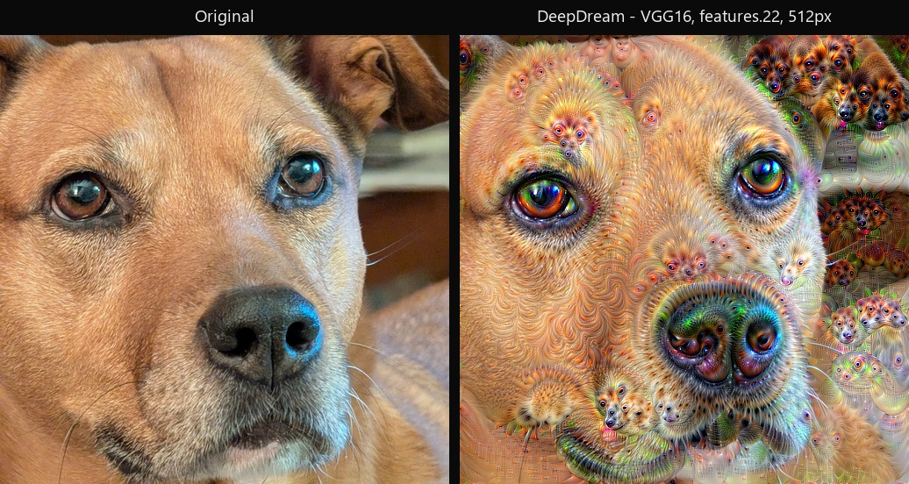
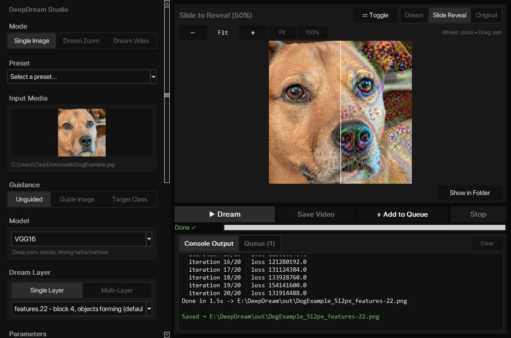

# DeepDream Studio

[](https://github.com/Clewless/DeepDreamStudio/actions/workflows/ci.yml)
[](LICENSE)


A PyTorch based local backend and GUI for creating "DeepDream" images. DeepDream images are known for their intricate, psychedelic-like patterns, produced by amplifying the features a neural network has learned to detect. Inspired by Alexander Mordvintsev et al. (Google) 2015 "Inceptionism: Going Deeper into Neural Networks".

Runs on Windows, macOS, and Linux, with CUDA, Apple Silicon (MPS), or CPU.





## How to run

```bat
Launch.bat     REM Windows launcher script
```

```sh
./Launch.sh   # macOS / Linux launcher script
```

- **Windows:** Double-click `Launch.bat`.
- **Linux:** Run `./Launch.sh` from a terminal (see [Troubleshooting](#troubleshooting)).
- **macOS:** Run `./Launch.sh` from a terminal (see [Troubleshooting](#troubleshooting)).

The first launch sets everything up automatically (see [First launch](#first-launch)).

Select an image from your disk by either dragging and dropping it in the window or browsing your files using your default file browser. Press the "Dream" button, and that's it!

You can inspect your images using the built-in photo viewer, and find them on your disk in the "out" folder of this program's root. Generated images are saved automatically. For zoom or video runs, click **Save Video** in the GUI to export the generated frames as an MP4; source audio is copied when available for video-mode runs.

## Troubleshooting

> - **macOS "unidentified developer" warning:** right-click the `.sh` file, click Open, and confirm once. Always run the script from a terminal; double-clicking opens it in an editor instead of running it.
> - **Linux won't run the script:** double-clicking opens the file in an editor. Run `chmod +x Launch.sh CLI/LaunchCLI.sh` once, then run the script from a terminal.
> - **First run downloads a lot:** Python packages are about 200 MB (CPU) or 2.5 GB (NVIDIA GPU), plus 50–550 MB of model weights. Keep the window open and keep about 5 GB of free disk space.
> - **Don't move a working folder between computers:** `.venv` is tied to its machine and path. Copy only the source files, then run the launcher on the new machine to create a fresh environment.

## Repository layout

```text
.
├── Launch.bat                   # GUI launcher (Windows), start here
├── Launch.sh                    # GUI launcher (Linux/macOS), start here
├── CLI/                         # Optional CLI preset launchers and full CLI docs
│   ├── LaunchCLI.bat            # One-shot CLI preset (Windows)
│   ├── LaunchCLI.sh             # One-shot CLI preset (Linux/macOS)
│   └── README.md                # Full CLI options and documentation
├── app/                         # Application package (engine + GUI)
│   ├── gui.py                   # GUI entry point
│   ├── deepdream.py             # Engine and CLI entry point
│   ├── protocol.py              # Structured progress events (CLI -> GUI)
│   ├── bootstrap.py             # First-launch setup helpers
│   ├── check_deps.py            # First-launch setup helpers
│   └── ...
├── tests/                       # Test suite
├── docs/images/                 # README screenshots and example results
├── requirements*.txt            # Dependencies
├── pyproject.toml               # Wheel build metadata and dev tool config
├── README.md
├── LICENSE                      # Project license (BSD-3-Clause)
└── THIRD_PARTY_NOTICES.md       # Third-party licenses
```

### Running from source

The launchers live at the repository root, while the application modules live in `app/`. From the root, run:

```bash
python -m app.gui         # GUI
python -m app.deepdream   # CLI
```

The project also builds an installable wheel, which provides `deepdream` and `deepdream-studio` commands:

```sh
python -m pip install .
deepdream photo.jpg
deepdream-studio
```

The installed version and the repository can coexist; the launchers always use the local `app/` package.

## Install

Requires Python 3.11, 3.12, 3.13, or 3.14*.

*Python 3.14 is currently not supported on macOS.

On Linux, install Tkinter if needed — without it the GUI launcher stops with an error telling you the exact command:

```sh
# Debian/Ubuntu
sudo apt install python3-tk
# Fedora
sudo dnf install python3-tkinter
# Arch
sudo pacman -S tk
# macOS (Homebrew ships Tkinter separately — match your Python version)
brew install python-tk@3.13  # e.g. python-tk@3.11 for Python 3.11, python-tk@3.12 for 3.12
```

The first time you run one, it creates `.venv`, installs the right requirements (CUDA or CPU), and verifies the install. See [First launch](#first-launch). The manual steps below are only for setting up an environment yourself to troubleshoot, or when working without the launcher scripts.

For NVIDIA GPUs use the CUDA requirements; otherwise use the standard requirements (CPU on Linux, CPU/MPS on macOS).

**Windows (PowerShell):**

```powershell
python -m venv .venv
.venv\Scripts\python.exe -m pip install --upgrade pip
# NVIDIA GPU, CUDA 12.8:
.venv\Scripts\python.exe -m pip install -r requirements-cuda.txt
# CPU:
.venv\Scripts\python.exe -m pip install -r requirements.txt
```

**macOS (Python 3.11–3.13):**

```sh
python3.13 -m venv .venv
.venv/bin/python -m pip install --upgrade pip
# CPU / Apple MPS:
.venv/bin/python -m pip install -r requirements.txt
```

**Linux:**

```sh
python3 -m venv .venv
.venv/bin/python -m pip install --upgrade pip
# NVIDIA GPU on Linux, CUDA 12.8:
.venv/bin/python -m pip install -r requirements-cuda.txt
# Otherwise:
.venv/bin/python -m pip install -r requirements.txt
```

### First launch

On first run, each launcher will:

1. Find a supported Python interpreter (3.11–3.14 on Windows and Linux; 3.11–3.13 on macOS).
2. Create `.venv` if it is missing, or repair it if the interpreter is broken or too old — the old folder is *renamed* to `.venv.bad-<timestamp>` after confirmation, never deleted.
3. Install dependencies into `.venv` via `app/check_deps.py` (choosing `requirements-cuda.txt` on NVIDIA machines, otherwise `requirements.txt`), then confirm the stack imports before starting.

If the CUDA packages cannot be installed — a blocked or throttled connection to the PyTorch wheel index is the usual cause — the launcher retries with the standard CPU packages so you still get a working app, just without GPU acceleration.

If a GPU is detected but cannot actually start (a driver too old for the pinned CUDA build, or an unsupported GPU architecture), the run automatically continues on the CPU instead of stopping.

The launcher creates `.venv` here and does not install or alter system Python. Model weights are downloaded to PyTorch's cache on first use. If no supported Python is found, the launcher prints an install command for your system and exits:

| System | Command |
|---|---|
| Windows | `winget install Python.Python.3.14` (or python.org; tick "Add python.exe to PATH") |
| Debian/Ubuntu | `sudo apt update && sudo apt install python3 python3-venv python3-tk` |
| Fedora/RHEL | `sudo dnf install python3 python3-tkinter` |
| Arch Linux | `sudo pacman -S python tk` |
| macOS | `brew install python@3.13 python-tk@3.13` (or install Python 3.13 from python.org, which bundles Tkinter) |

The `python3-tk` / `python3-tkinter` / `tk` / `python-tk@X.Y` packages are only needed for the GUI; CLI-only use can skip them.

The import check is cached in `.deps_ok` and re-runs automatically if the requirements files or Python version change.

On Windows the GUI launcher writes startup output to `deepdream-launch.log` next to the launchers: if the Studio window never appears, that file has the error.

## Command line

For CLI usage, options, models, video/animation modes, and tuning tips, see **[CLI/README.md](CLI/README.md)**.

The `CLI/` folder also contains optional one-shot preset launchers (`LaunchCLI.bat` / `LaunchCLI.sh`) for drag-and-drop or quick single-image runs without opening the GUI.

## Credits and licenses

This project is an independent, modern PyTorch implementation of the 2015 DeepDream technique, inspired by the original work and code by Alexander Mordvintsev and colleagues at Google. Pretrained model weights and ImageNet labels come from `torchvision`. Video encoding uses FFmpeg through `imageio-ffmpeg`. See [THIRD_PARTY_NOTICES.md](THIRD_PARTY_NOTICES.md) and [LICENSE](LICENSE) for license details.

DeepDream Studio aims to be a modern, self-contained DeepDream tool: a single launcher, fully local execution, and no cloud dependency.

Much of the application code in this repository was generated with the assistance of AI coding agents. See [LICENSE](LICENSE) for the project's licensing terms.
